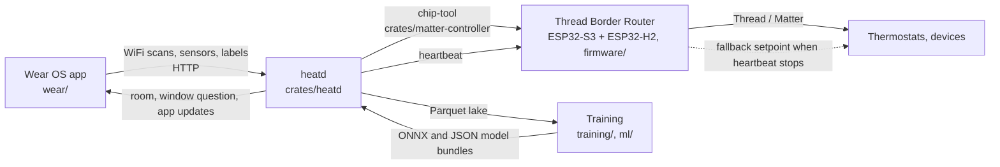

# MLSmartMatterHeat

A local heating controller for one home: a Rust daemon (`heatd`) drives Matter-over-Thread radiator thermostats, a Wear OS app reports WiFi scans from which the daemon infers the room you are in, and models trained offline in Python feed back into the control rules. It runs on a small Linux host in the home network, without a cloud service.

## What it does

- Controls each room's thermostat setpoint from schedules, presence (room inferred from the watch's WiFi scans, sleep state) and an away mode that lowers the setpoint. Every decision is logged before it is written.
- Detects open windows from a learned valve/temperature residual model, vetoes it when the boiler supplies no heat, and asks the watch for confirmation.
- Schedules a "boost" (short, higher setpoint) in the morning and on homecoming; the dose comes from a learned model and is blocked after a window episode. Manual boost and manual setpoint holds are available through the HTTP API.
- Keeps the house safe when the controller fails: `heatd` writes a fallback setpoint on shutdown, a host watchdog resets thermostats when `heatd` stays down, and the ESP32 Thread Border Router sends the fallback setpoint itself when its heartbeat from `heatd` stops.
- Detects silent or deviating devices itself (node health) and records raw data from additional Matter devices (plugs, climate and air sensors) into the data lake.
- Stores all raw data as Arrow/Parquet with DuckDB views, and produces a daily report and Prometheus metrics.

## Architecture



- `heatd` is one process (axum HTTP API, tokio). It evaluates the control rules, talks to thermostats through a `MatterController` trait (`ChipToolController` runs `chip-tool` as a child process; `MockController` is used in tests and for running without hardware), and writes raw data to a DuckDB/Parquet lake.
- Inference runs inside `heatd`: the WiFi room matcher is loaded as ONNX through the `ort` crate (`infer.rs`, `watchmatch.rs`); the window, boost, thermal and room models are JSON parameter bundles evaluated natively in Rust. Nothing is evaluated on the ESP32 or on the watch.
- The watch app collects WiFi scans and sensor data, uploads them in bursts, shows the inferred room and answers window and boost prompts. It does no model inference.
- The ESP32 firmware is an OpenThread Border Router (ESP-IDF, `esp-thread-br`) extended with a watchdog (`watchdog*.c`) and a small Matter client (`firmware/br/matter_client`, Rust, C bindings) that writes the fallback setpoint.
- Training runs nightly in a container (`deploy/train`) or on a PC (`deploy/pc-train/nightly.sh`): it reads the lake, fits the models, and exports versioned bundles that `heatd` reloads.

## Tech stack

- Rust 2021: `tokio`, `axum`, `duckdb` (bundled), `arrow`/`parquet`, `ort` (ONNX Runtime), `ureq`, `serde`, `toml` (`crates/heatd`); `async-trait`, `thiserror` (`crates/matter-controller`).
- Matter: `chip-tool` built from the connectedhomeip tag set in `deploy/docker/Dockerfile`, packaged with `heatd` in one image.
- Python 3.12+ with `uv`: `numpy`, `scipy`, `scikit-learn`, `xgboost`, `skl2onnx`/`onnxmltools`, `duckdb`, `pyarrow` (`training/`, `ml/`); `pytest` for tests.
- Kotlin, Jetpack Compose for Wear OS (Material 3), Wear Tiles, Gradle (`wear/`); compileSdk 37, minSdk 30.
- C on ESP-IDF 5.5 for the border router (target ESP32-S3), plus a `no_std` Rust crate (`p256`, `ccm`, `hkdf`, `aes`) for the Matter client.
- Docker and Docker Compose for deployment; systemd units for the host watchdogs, network guard and training timers.
- SQL (DuckDB views in `analysis/` and `crates/heatd`).

## Repository layout

| Path | Content |
|---|---|
| `crates/heatd` | The daemon: HTTP API, control rules, window and boost logic, data lake, ONNX inference, CLI |
| `crates/matter-controller` | `MatterController` trait with `ChipToolController` and `MockController` |
| `wear/` | Wear OS app (Kotlin), build script `wear/build.sh` |
| `firmware/` | Border router: ESP-IDF project, watchdog, Matter client crate, host tests, `esp-thread-br` submodule |
| `training/` | `heattrain`: room matcher, window, boost, thermal and room models |
| `ml/` | `heatml`: early room classifier, window baseline, synthetic scan generator |
| `contract/` | Data contract between watch, `heatd` and training (JSON examples, feature vector) |
| `analysis/` | DuckDB views (per-room one-minute grid) |
| `deploy/` | Docker image and compose file, systemd units, install and publish scripts |
| `docs/` | Documentation (mostly German); `docs/overview.de.md` is the German overview |
| `heatd.example.toml` | Configuration template |

## Getting started

Hardware prerequisites for a real installation: Matter thermostats on Thread, a Thread Border Router (the ESP32-S3 board from `firmware/`, or another one), a Linux host for `heatd`, and a Wear OS watch for room detection. The tests and the mock controller need none of them.

Build and test the Rust workspace (needs a C++ toolchain for the bundled DuckDB):

```bash
cargo build --release
cargo test --workspace -j 4
cargo clippy --workspace --all-targets -j 4
```

Run `heatd` without hardware:

```bash
cp heatd.example.toml heatd.toml    # set controller = "mock", adjust rooms and node ids
cargo run --release -p heatd -- serve
curl http://127.0.0.1:8080/health
```

`heatd` also has CLI subcommands for `commission`, `read`, `set`, `inventory` and `thread form` (see `crates/heatd/src/main.rs`).

Wear OS app (uses Docker with an Android SDK image; add `heatscan.home` and `heatscan.server` to the gitignored `wear/local.properties`, and `wear/keystore.properties` for signed release builds):

```bash
sh wear/build.sh testDebugUnitTest
sh wear/build.sh assembleRelease
```

Training:

```bash
cd training && uv run pytest
cd training && uv run python -m heattrain watchroom <lake-dir> <models-dir>
cd ml && uv run pytest
```

Container deployment (details and prerequisites in `docs/setup.md`, in German):

```bash
docker build -t heatd:local -f deploy/docker/Dockerfile .
MINIX=<user@host> bash deploy/docker/minix-up.sh
sudo DEPLOY_USER=<user> HEATD_ROOT=<install-dir> deploy/install-units.sh
```

Firmware (needs ESP-IDF 5.5 and, for the host tests, a C compiler):

```bash
git submodule update --init
IDF_PATH=<path-to-esp-idf> bash firmware/br/test/run.sh
(cd firmware/br/matter_client && cargo test)
.\firmware\build.ps1 -Variant wifi -Port <COM-port>
```

Shell tests: `bash deploy/netguard/test.sh`.

## Status and limitations

- This is a prototype built for and operated in a single home. Room names, node ids, thresholds and the watch's home WiFi are configuration, not a general product.
- The room model (Kalman filter per room with a cost-based planner, `room_model*.rs`, `room_shadow.rs`, trained by `heattrain roommodel`) runs in shadow mode: it computes setpoints and writes them to a `shadow_decisions` table, but its hook receives the desired setpoints read-only and cannot write to a thermostat. The live rules do not use it.
- ML inference runs in `heatd` on the server, not on the ESP32 and not on the watch. Only the WiFi room matcher is an ONNX model; the other models are parameter bundles interpreted in Rust.
- The room matcher needs labelled scans from your own home; there is no pretrained model in the repository beyond test fixtures.
- The user-facing strings in the watch app and most documents under `docs/` are in German; code identifiers and API names are English.
- No continuous integration is configured. Tests run locally: over 450 unit and integration tests in `heatd`, plus the controller, training, watch app and firmware tests listed above.

## Security

The HTTP API is meant for a trusted home LAN and is protected in three layers (`crates/heatd/src/http.rs`, configured in `[http]` and described in German in `docs/heatd.md`):

- Source check: before anything else, requests whose peer address is not loopback, RFC1918, IPv4 link-local, IPv6 ULA or link-local (or inside a subnet listed in `trusted_subnets`) get `403`.
- Bearer tokens with two roles: `admin` (everything) and `watch` (only the endpoints the watch app uses). Tokens are compared in constant time and live in files outside the repository (`secrets/`, gitignored); the configuration holds only their paths, and `heatd` refuses to start with a missing, too short or placeholder token. Each role has a rollout mode, `off`, `log` (accept and count requests without a token, visible in `/metrics`) or `enforce`, so tokens can be introduced without breaking installed clients. `/health` is always open; `/metrics` is open unless `metrics_require_admin` is set.
- Limits: request body size and request timeout; no CORS headers are sent.

`heatd` does not terminate TLS, so inside the LAN the traffic, tokens included, is plain HTTP. To encrypt it, put a reverse proxy with a certificate on the same host and bind `heatd` to `127.0.0.1` (`listen`). The API must not be exposed to the internet.

## License

GPL-3.0-or-later, see [LICENSE](LICENSE).
