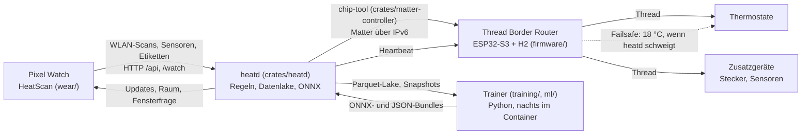

# MLSmartMatterHeat

Local, cloud-free heating control: a Rust daemon (`heatd`) talks Matter over Thread to radiator thermostats, a Pixel Watch app detects which room you are in from WiFi scans, and small ML models (room matcher, window detection, boost dosing, thermal model) are trained locally.
An ESP32 Thread Border Router also acts as a hardware failsafe. Documentation is in German, the code and API names are English.

**Heizung, die weiß, in welchem Raum du bist.** Ohne Cloud und Hersteller-App, alles im eigenen LAN. Die Pixel Watch misst alle 30 s das WLAN-Umfeld, ein Modell erkennt daraus den Raum, `heatd` regelt damit die Matter-Thermostate (Eurotronic Comet Zero) über Thread.

## Architektur



`heatd` läuft in Docker auf einem kleinen Heimserver (Ubuntu, `network_mode: host`), der Border Router ist ein eigenes Board mit eigener Stromversorgung.

## Funktionen

- **Thermostatregelung** je Raum: Zeitplan, Anwesenheit (Raum aus dem WLAN-Matcher, Schlafzustand der Uhr), Abwesenheit senkt auf 18 °C. Jede Entscheidung wird vor dem Schreiben protokolliert. Ein Anhebungs-Budget je Raum verhindert dauerndes Umschalten. Details: [docs/heatd.md](docs/heatd.md).
- **Fenster-offen-Erkennung** mit gelerntem Physik-Residuum-Modell (Ventil, Außentemperatur, Strahlung), Kessel-Veto bei fehlender Wärmeversorgung, Rückfrage an die Uhr.
- **Boost** nur morgens und bei Heimkehr, Dosis aus einem gelernten Modell mit Risikogrenze, nach einem offenen Fenster gesperrt; manuell über `POST /api/boost`. Siehe [docs/boost.md](docs/boost.md).
- **Manuelle Vorgabe** per API und Uhr: `POST /api/setpoint` hält eine Temperatur für eine Dauer (15 bis 720 min).
- **Ausfallsicherheit** in drei Schichten: `heatd` schreibt beim Beenden 18 °C, ein Host-Watchdog stoppt und setzt 18 °C, und der Border Router schreibt 18 °C, wenn zehn Minuten kein Heartbeat kommt (`firmware/br/main/watchdog*.c`, [docs/br-watchdog.md](docs/br-watchdog.md)). Dazu eine Obergrenze im Gerät.
- **Geräte-Gesundheit**: `heatd` erkennt stumme oder abweichende Thermostate selbst, repariert und meldet ([docs/node-health.md](docs/node-health.md)).
- **Uhr-App HeatScan** (Wear OS): Raumetiketten, Fensterfrage, Boost, manuelle Vorgabe, Alarme, Kachel, und **Selbst-Update** vom eigenen Server (`GET /watch/update`).
- **Zusatzgeräte** (`[[devices]]`, Matter): Stecker, Klima- und Luftsensoren werden roh in den Datenlake aufgenommen und nur gelesen. Einzige Schreibaktion: die Kaffeemaschine (`wake_on`) geht an, wenn die Uhr das Aufwachen meldet.
- **Datenlake**: alle Rohdaten als Arrow/Parquet, DuckDB-Views für das Training ([docs/data-foundation.md](docs/data-foundation.md)), Tagesbericht, Prometheus-Metriken.

Das thermische Raummodell (Kalman-Filter für die Raumluft, Parameterfit in `training/`) ist als Trainer vorhanden; die Regelung nutzt es auf `main` noch nicht.

## Schnellstart

```bash
cargo test --workspace -j 4            # ohne Hardware, Mock-Controller
cp heatd.example.toml heatd.toml       # Räume, Node-IDs, Zeitpläne anpassen; controller = "mock" startet ohne Thermostate
cargo run --release -p heatd -- serve  # HTTP auf listen (Standard 0.0.0.0:8080), GET /health
```

Echter Betrieb (Border Router flashen, Docker-Deployment, Failsafe, Commissioning): [docs/setup.md](docs/setup.md). Die API hat keine Authentifizierung und gehört nur ins LAN.

## Repository

| Pfad | Inhalt |
|---|---|
| `crates/matter-controller` | Rust, Trait `MatterController`: Commissioning, Lesen, Schreiben, Subscriptions; Backends `ChipToolController` (echt) und `MockController` (Tests) |
| `crates/heatd` | Rust, der Dienst: HTTP-API, Regeln, Fenster, Boost, Datenlake, ONNX-Inferenz, CLI |
| `firmware/` | ESP32-Border-Router (ESP-IDF, `esp-thread-br` als Submodul), Watchdog und Matter-Client (`firmware/br/matter_client`, Rust) |
| `wear/` | Kotlin, Wear-OS-App HeatScan ([wear/README.md](wear/README.md)) |
| `training/` | Python (uv), `heattrain`: Raum-Matcher, Fenster-, Boost- und thermisches Modell |
| `ml/` | Python (uv), `heatml`: früher Raumklassifikator, Fenster-Baseline, synthetische Scans |
| `contract/` | Datenvertrag zwischen Uhr, heatd und Training: JSON-Beispiele, Feature-Vektor, Schema |
| `analysis/` | DuckDB-Views (1-Minuten-Raster je Raum) |
| `deploy/` | Docker, systemd-Units (Failsafe, Netguard, Training, Ambient), Skripte |
| `docs/` | Dokumentation, siehe unten |
| `heatd.example.toml` | Konfigurationsvorlage |

## Dokumentation

| Datei | Thema |
|---|---|
| [docs/setup.md](docs/setup.md) | Border Router flashen, Server einrichten (Docker oder systemd), Failsafe, Commissioning, Inventar |
| [docs/heatd.md](docs/heatd.md) | Konfiguration, Regeln, Fenster, Boost, Zusatzgeräte, API |
| [docs/training.md](docs/training.md) | Uhr und Etiketten, Raum-Matcher, thermisches Modell, nächtliches Training |
| [docs/boost.md](docs/boost.md) | Gelernter, szenariogebundener Boost |
| [docs/node-health.md](docs/node-health.md) | Erkennung und Reparatur von Thermostat-Ausfällen |
| [docs/br-watchdog.md](docs/br-watchdog.md) | Watchdog zwischen Border Router und heatd (beide Richtungen) |
| [docs/ambient-sources.md](docs/ambient-sources.md) | Umgebungswerte als schwache Proxies |
| [docs/data-foundation.md](docs/data-foundation.md) | Arrow-Schemata und Views des Datenlakes |
| [docs/phase1-spec.md](docs/phase1-spec.md), [docs/phase1b-watch-matchers.md](docs/phase1b-watch-matchers.md) | ursprüngliche Entwurfsaufträge (Historie, der Code ist maßgeblich) |
| [contract/README.md](contract/README.md) | Datenvertrag Uhr und heatd |
| [deploy/br-watchdog/README.md](deploy/br-watchdog/README.md), [deploy/netguard/README.md](deploy/netguard/README.md) | Border-Router-Firmware-Watchdog, Netzwerk-Wächter |

## Daten und Datenschutz

Alles bleibt im eigenen Netz: keine Cloud, keine Telemetrie. Nur zwei optionale Abrufe gehen nach außen: Wetter von Open-Meteo (nur mit gesetzten Koordinaten) und NTP-Drift-Check. Nicht im Repository (per `.gitignore`): `heatd.toml`, `data/` (Datenlake, DuckDB), `models/`, `chip-storage/` (Matter-Fabric-Schlüssel), `secrets/` (Thread-Dataset), `inventory/` (Geräteinventar), `deploy/docker/.env`, `wear/local.properties` und die Signaturdaten der App, `firmware/br/sdkconfig*.local` (WLAN-Zugang des Border Routers). Beispielwerte (Koordinaten, Adressen, Räume) in Vorlagen und Tests sind Platzhalter. Die Uhr sendet WLAN-Fingerabdrücke und Sensorwerte nur an den eigenen Server.

## Entwickeln

```bash
cargo test --workspace -j 4 && cargo clippy --workspace --all-targets -j 4 -- -D warnings
cd ml && uv run pytest
cd training && uv run pytest
sh wear/build.sh                       # Tests + signierte Release-APK (Docker)
```

Wer die Uhr-App selbst baut, legt `wear/local.properties` und `wear/keystore.properties` an (beide gitignored). Lizenz: GPL-3.0-or-later, siehe [LICENSE](LICENSE).
